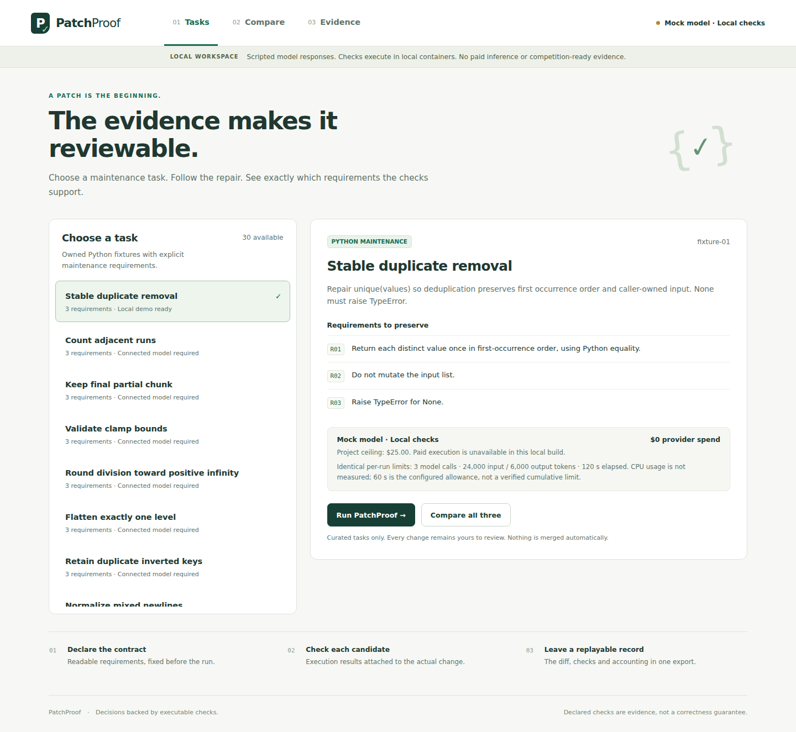

# PatchProof

A maintenance agent that checks real model-generated patches against independently
controlled requirements and exports a patch with replayable evidence.

The live application connects NVIDIA Nemotron on **Nebius Token Factory** to
independently controlled checks in isolated local Docker containers. It accepts
curated maintenance task IDs and exports the patch, requirement checks, request
IDs, usage and immutable runtime evidence. The historical local development mode
still uses explicitly labeled scripted responses.

**Public app:** https://patchproof.andrewmohawk.xyz/

**Recording:** https://patchproof.andrewmohawk.xyz/demo/

**October 16 status:** New repairs remain operator-paused. Two curated tasks are
exposed by the deployed service; the repository contains ten synthetic tasks.
A two-lane container scheduler has completed both repeated baselines on Andromeda.
Current account pricing is reverified, but supervised paid repair validation,
guarded rollout and maintained judge availability remain open. See the
[October 16 repair evidence](research/verification/20261016-demo-repair/README.md)
and [release readiness](docs/release-readiness.md).

Start with a saved walkthrough, then open **Try a repair** to inspect one of the two currently exposed
v3 Python maintenance tasks. Each task shows the starting source, the
behavior to repair, five requirements, and five selectable input/expected-output
examples. The repository corpus covers configuration overlays, cursor pagination, inventory,
invoices, caches, schedules, manifests, event processing, retry batches, and search.
They are original synthetic examples with interacting rules, not a benchmark of
production repositories.

**How it works** explains the model, protected checks, evidence, and the reviewer’s
role. Successful and failed walkthroughs both use four stages: **The bug → AI
patch → Check results → Your decision**. Patches use a GitHub-style diff with file
headers, original/proposed line numbers, and expandable unchanged context. Failed
attempts remain inspectable. Nothing is merged automatically.

The [product v3 record](research/product-v3/README.md) is the index for this upgrade.
The historical ten-task interface was [reviewed on the public app](research/product-v3/public-review/review.md).
The successful walkthrough follows a real Super pagination repair: the original
passed 16 of 22 checks, the proposed repair passed all 22, and a fresh same-host
replay reproduced the result. The complete configuration failure shows why
17 passing checks did not establish a completed fix. Earlier failed trials remain
visible. The 149.76-second recording includes on-screen annotations, local
Chatterbox narration, a transcript, and direct links to both saved examples.

See the [live deployment guide](docs/live-demo.md) for runtime and accounting
boundaries. Nebius-hosted Sandboxes and the sealed competition evaluation remain
separate gates. This is an unscored development demo, not a measured performance
claim.

New evidence uses product contract **2.2**, preserving ordinary JSON mapping keys
throughout checking and export. Historical 2.0/2.1 bundles retain their original
bytes and interpretation; see [JSON compatibility](docs/json-contract-compatibility.md).

The owner approved **$25 total**: $5 allocated to smoke and $20 to a pilot. The
September 28 recorded v3 configuration uses `nvidia/nemotron-3-super-120b-a12b` on Token
Factory, with a **$0.25 hold per run**, at most **three model calls**, **12,000 total
output tokens**, and **600 seconds**. The [public runtime check](research/product-v3/public-review/mobile-fixes.json)
records those historical limits; older saved runs retain their own recorded allowances. Actual invoice costs remain unknown and reservations stay
held; displayed token-based costs are estimates. See the [model discovery
receipt](research/product-v3/model-discovery.json), [decisions](decisions.md),
[budget](budget.json), and [account access receipt](research/verification/20260927-account-access/README.md).

## Local development (scripted model)

Requirements: Linux, Node **25.5.0**, npm **11.8.0**, Git, `/usr/bin/python3`
and a local Docker daemon accessible to the operator. Candidate code executes
only in containers. Exact dependencies and licenses are recorded in the npm
lockfile and [third-party notices](THIRD_PARTY_NOTICES.md).

```sh
npm ci --ignore-scripts --no-audit --no-fund
make doctor
make test
make dev
```

Open **http://127.0.0.1:43171/#tasks**. Select **Retain first occurrences throughout a list**
(`stable-unique-01`), compare the three
policies, inspect a rejected candidate's actual check output, and download its
evidence. The scripted provider supports this one task. Other fixtures may be inspected,
but generating their patches requires a connected model. The public live
service currently allows configuration overlays and cursor pagination only.

`make doctor` makes no paid calls. If the pinned local checker image is absent,
it reports the blocker; there is no automatic image pull or provider fallback.
The required image and local controls are in [the runtime guide](workers/sandbox/README.md).
This Linux/amd64 build has not been verified on another platform.

On a new Linux/amd64 machine, provision that exact image explicitly before
starting the checker:

```sh
docker pull --platform linux/amd64 python@sha256:79e7a9b9ff1cbceff819f856fb374477792a5967759d94df266de7b7b4120e6f
```

The development API binds to loopback, accepts curated task IDs, and has no upload, arbitrary
command, remote URL, merge or publishing route. Set `PATCHPROOF_PORT` to choose
another loopback port. Use the separately configured live Unix-socket application for public hosting.

## Commands

| Command | Current behavior |
|---|---|
| `make doctor` | Reports local runtime, fixtures, approval and provider blockers; no paid calls. |
| `make test` | Type checks, contract locks, unit/HTTP/evaluation tests and real local container lifecycle tests. |
| `npm run test:browser` | Starts an isolated local app, runs all three policies, checks desktop/mobile flow and exports evidence. Requires installed Playwright Chromium. |
| `npm run record:rehearsal` | Performs that flow and records a local mock rehearsal, captions and a run-bound claims manifest under `.local/rehearsal/`. Nothing is published. |
| `npm run run -- stable-unique-01 patchproof` | Runs the same local coordinator from the CLI; stop `make dev` first because one process owns its state. |
| `make export RUN=<id>` | Exports local mock evidence. With private `CONFIG` and `CONFIG_DIGEST`, verifies and exports exact completed smoke evidence. |
| `make reproduce RUN=<id>` | Replays local evidence in fresh pinned containers. Real-inference/local-check bundles use their exact source checkout and image; sponsor-Sandbox replay requires private `CONFIG` and `CONFIG_DIGEST`. |
| `make smoke` | Exits 2 without configuration. `make smoke CONFIG=<absolute-private-json>` invokes the guarded operator; verified account, tokenizer, control and budget inputs are required. |
| `make pilot` / `make evaluate` | Exit 2 without configuration. Explicit private session/runtime configs invoke the guarded experiment operator; see its guide below. No live experiment has run. |
| `make release-check` | Audits local contract/dependency pins, public fixtures and release prerequisites; exits 2 while the real release gates remain open. |
| `make release-packet INPUT=<relative-json>` | Builds a private immutable packet from explicitly selected, scanned exports; receipt requirements are in the release guide. |
| `make verify-packet PACKET=<path> DIGEST=<sha256>` | Verifies a local packet's exact file set, checksums and embedded evidence. |

Install the pinned browser if needed with `npx playwright install chromium`.
For a browser download, save the bundle as `artifacts/<run-id>.json` before using
`make reproduce`. Self-consistent hashes establish integrity, not authenticated
provenance. A replayed mock-model run remains mock and cannot become competition
ready. The original v1 contract-only scaffold is retained for historical tests;
`npm run mock-run` produces that older non-executable format, not product evidence.

## Live deployment and evidence

The implemented public application uses real Token Factory inference and checks candidate
Python code in isolated local Docker containers. Every run records its exact
model, source, allowance, observations, and evidence digest. Earlier runs retain
their original runtime locks when the interface or model configuration changes.

Use the [product v3 record](research/product-v3/README.md) for the final deployment,
run, replay, and recording receipts. Public UI inspection
has verified the ten-task catalogue, source and example controls, How it works,
both four-stage walkthroughs, and the context diff at desktop and mobile sizes.
That inspection starts no model calls; the separate actual-run and replay
receipts establish the recorded pagination outcome.

Historical evidence remains available:

- The [original live deployment record](research/verification/20260928-live-deployment/)
  preserves real Nano operations, unsuccessful attempts, matched development
  examples, fresh-container replays, and recordings. The list example passed its
  nine declared checks; a separate worksheet repair failed. These examples do not
  establish general repair reliability or a performance advantage.
- The [interface redesign record](research/interface-redesign/README.md) preserves
  the earlier workbench design, independent reviews, public browser verification,
  and its recording custody.
- The [judge walkthrough record](research/judge-experience/README.md) preserves the
  later explanatory walkthrough and its captioned recording. Its
  [presenter notes](research/judge-experience/presenter-notes.md) describe that
  historical demonstration; current recording evidence is in the v3 record.

Release IDs, test totals, video durations, and playback observations belong to
those dated receipts. They are not claims about whichever release or video is
currently served. The scored pilot and sealed evaluation have not been completed.

## Historical local validation

Core workflow verification at source `06c584c` passes all **622 tests**, the actual
desktop/mobile comparison and all three fresh-container patch replays. An
unsupported-task run honestly abstained with no selected patch. The four selected
exports were scanned, packaged and verified locally; this did not satisfy the
competition release gates. The [integration receipt](research/verification/20260927-completion-audit/integration-receipt.json)
records those results, confirmed cleanup for all 246 operations and $0 provider spend.

The later archive recorder at `4574e74` passes **628 tests**, type checking and
contract checks. It records selected existing evidence without starting work,
pins all displayed response bytes and refuses redirects or write requests. See
the [recording guide](docs/archive-recording.md) and
[recorder verification](research/verification/20260927-archive-recorder/recorder-verification.json).
The [actual walkthrough receipt](research/verification/20260927-archive-recorder/actual-walkthrough-custody.json)
binds a **42.84-second captioned MP4** to the saved `06c584c` mock run and this
recorder. A four-run interactive evidence archive is available locally at
`http://127.0.0.1:43173`, including the abstention. Viewing and recording start no
new inference or checks; the separate Token Factory marker result is not repair
evidence. The video is private and has not been published.



See the [reviewer walkthrough](docs/reviewer-guide.md) and recorded
[comparison](docs/screenshots/comparison.png) / [evidence](docs/screenshots/evidence.png) screens.
These screens come from the v2 local comparison at source `06c584c`. All three
scripted policies passed their declared checks; this is workflow validation,
not evidence of a performance advantage. The [verification record](research/verification/20260927-completion-audit/README.md)
binds those historical results. The [prior integration record](research/verification/20260927-corpus-v2-integration/README.md)
separately preserves the earlier failures and `c335031` walkthrough/video evidence.

- SQLite journal, coordinator ownership lease, cancellation, scoped restart
  reconciliation and content-addressed evidence persist locally in `.local/product/`.
- B0 receives visible feedback; B1 receives declared acceptance feedback; P can
  propose up to three candidates against the original snapshot. All policies use
  one shared allowance per episode. No sealed final checks enter the repair loop.
- Each declared check now runs twice under the same batch deadline. Both
  observations appear in evidence; disagreement produces `needs_review`.
  B0/B1 retain the latest candidate; P selects the best declared-check result,
  with the earliest candidate winning a tie.
- New exports bind the executable source and configuration. Replay requires the
  recorded checkout; a running app refuses new runs after those files change.
  Historical exports keep their original explicitly versioned replay behavior.
- The historical v2 evaluation suite has 60 original synthetic tasks from 12 fresh AI author
  contexts, independently reviewed and validated, split 20/10/30 by repository.
  [Provenance and preparation history](research/corpus-v2/README.md) preserve the
  two infrastructure failures and reviewed reruns. Public development/calibration files are here;
  gold and sealed checks stay in the separate evaluator workspace. These are
  synthetic examples, not a representative sample of real repositories.
- Exact CPU consumption is unknown and displayed as such. The runner limits CPU
  rate and wall time; it does not supply a measured cumulative CPU counter.
- Fresh local replay is implemented. Independent clean-machine replay, sponsor
  traces, reconciled billing, the 72-episode pilot and 270-episode final are pending.

See [task evidence](research/task-evidence.md), [evaluation](docs/evaluation.md),
[operations](docs/operations.md), and [the submission draft](docs/submission-draft.md).
The [budget ledger](docs/budget-ledger.md), [reviewer study](docs/reviewer-study.md)
and [release evidence guide](docs/release-evidence.md) describe the new tools.
The [trusted dispatcher](docs/experiment-dispatcher.md) preserves full experiment
accounting. The [guarded live executor](docs/live-experiment-runtime.md) and
[private experiment operator](docs/live-experiment-operator.md) connect the existing
adapters, ledger, final adjudication and independently accepted phase receipts.
This experiment path is tested with fake transports; its required calibration
and sponsor-Sandbox account evidence remain absent. The public live demo uses
the separate verified Token Factory and local-container path described above.
The [synthetic experiment executor](docs/experiment-executor.md) tests up to 24
revisions across three branches using the same loop as the product. It rejects
live providers. [Accounting receipts](docs/accounting-reconciliation.md) support
trusted reconciliation and crash recovery. The [private accounting command](docs/accounting-operator.md)
imports separately reviewed receipts and recovers interrupted imports; actual
provider billing verification remains pending. The separate
[phase accounting operator](docs/phase-accounting-operator.md) records cumulative
runtime/adjudication observations without releasing holds or granting execution.
The [aggregate exporter](docs/experiment-export.md) and its
[private command](docs/experiment-export-operator.md) retain every planned episode
and verify immutable metadata bundles. Synthetic exports remain unscored; source
hashes do not establish which code a past dispatcher actually executed.
The [trusted smoke factory](docs/trusted-smoke.md) connects the provider adapters
and budget ledger for an explicitly configured integration run of at most three
proposals. The [private smoke operator](docs/trusted-smoke-operator.md) adds preflight,
durable single-attempt sessions, cancellation and status. Its tests use fake
transports; the sponsor-Sandbox account verification, calibrated ceilings and
actual sponsor-Sandbox smoke runs remain pending.
The [private evidence operator](docs/private-evidence.md) verifies and exports
completed smoke bundles. The [read-only archive](docs/evidence-archive.md) displays
selected recorded live/mock bundles without enabling a provider. The
[guarded replay operator](docs/replay-operator.md) repeats a selected live patch's
checks under a separate reservation; its provider tests are synthetic.
The [completion audit](docs/completion-audit.md) distinguishes implemented tools
from the remaining provider, billing, calibration and human evidence.
The original planning package remains in commit `4bf1335`; its `SHA256SUMS.txt`
refers to that original package. `tasks.json` is a living acceptance tracker.

## License and release scope

The owner selected the [MIT license](LICENSE) for original PatchProof software
and documentation and approved source and existing-demo publication preparation.
The [CC0 fixture dedication](fixtures/LICENSE-CC0.txt) and [third-party notices](THIRD_PARTY_NOTICES.md)
remain separate; MIT does not relicense third-party components or media.

The GitHub repository remains private pending a full-history secret and rights
review. The existing recording is hosted at the app's demo URL; no verified
YouTube publication is recorded here. Competition entry and acceptance of its
terms are separate steps. No competition entry or automatic merge has occurred.
